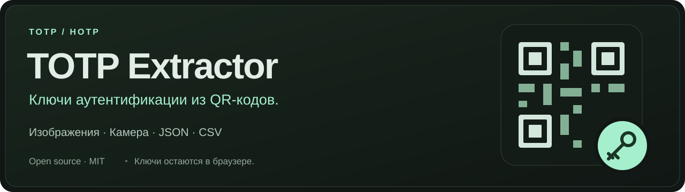

# TOTP Extractor — секретные ключи 2FA из QR-кодов

Получите секретный ключ из QR-кода аутентификатора, чтобы скопировать его, сохранить резервную копию или перенести аккаунт в другое приложение 2FA. **TOTP Extractor** читает QR-коды настройки TOTP/HOTP и экспорт Google Authenticator прямо в браузере.

**[🚀 Открыть в браузере — без установки](https://totp-extractor.github.io/)** · [English](../README.md)

## Перенесите 2FA в другой аутентификатор

1. **Добавьте QR-код.** Загрузите изображение, вставьте скриншот, включите камеру или вставьте ссылку `otpauth://`.
2. **Получите секретные ключи.** Проверьте список аккаунтов и скопируйте нужный ключ.
3. **Сохраните или перенесите.** Скачайте JSON или CSV для резервной копии либо считайте отдельный QR-код аккаунта новым аутентификатором.

Без установки и регистрации. Работает на телефоне и компьютере.

## 📷 Какие QR-коды поддерживаются

- **Настройка TOTP и HOTP** — извлечение секретного ключа Base32 и параметров аккаунта из стандартного QR-кода аутентификации.
- **Экспорт Google Authenticator** — один или несколько аккаунтов, в том числе экспорт из нескольких QR-кодов.
- **Изображения и скриншоты** — PNG, JPEG, WebP и BMP, несколько QR на одной картинке и обнаружение дубликатов.

Сохраните результат в **JSON, CSV или отдельных QR/PNG-изображениях**. Обратный импорт JSON и CSV пока не поддерживается.

Нужен **QR-код настройки или экспорта**. Скриншот шестизначного кода входа не содержит секретного ключа.

## 🔐 Ключи остаются в вашем браузере

Изображения и секретные ключи обрабатываются локально и не загружаются на сервер. Храните скачанные файлы в надёжном месте: они содержат незашифрованные ключи 2FA.

## Нужен инструмент на Python?

Посмотрите [scito/extract_otp_secrets](https://github.com/scito/extract_otp_secrets) — альтернативу на Python для командной строки. Этот проект вдохновил создание TOTP Extractor.

Открытый исходный код · [Лицензия MIT](../LICENSE) · [Свой сервер и разработка](DEVELOPMENT.md) · [Сторонние библиотеки](../public/third-party-licenses.txt)
